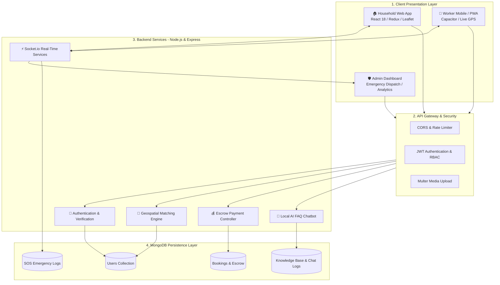
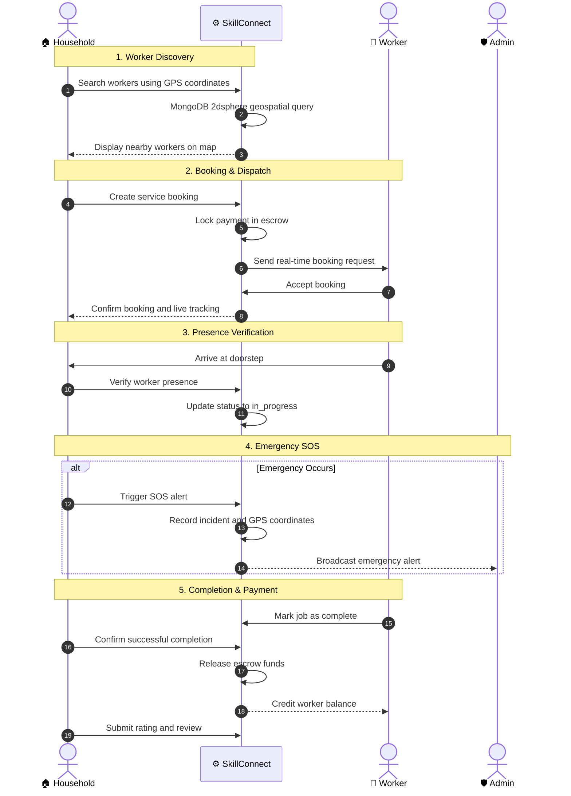

# 🚀 SkillConnect

An end-to-end decentralized gig-economy platform connecting households with verified skilled workers. SkillConnect provides **real-time geospatial tracking, secure escrow payments, doorstep presence verification, emergency SOS alerts, and an AI-powered offline support chatbot.**


---

## 📚 Table of Contents

- [Project Overview](#-project-overview)
- [Key Problems & Solutions](#-key-problems--solutions)
- [System Architecture](#️-system-architecture)
- [End-to-End System Workflow](#-end-to-end-system-workflow)
- [Features](#-role-wise-feature-matrix)
- [Tech Stack](#️-tech-stack--dependencies)
- [Environment Variables](#-environment-variables-configuration)
- [Installation](#-installation--how-to-run)
- [Project Structure](#-project-directory-structure)
- [Author](#-author)

---

## 📖 Project Overview

**SkillConnect** bridges the gap between households and verified informal gig workers such as plumbers, electricians, cleaners, and carpenters.

Traditional service-booking platforms often face problems such as worker impersonation, payment disputes, unreliable service dispatch, and a lack of emergency safety mechanisms.

SkillConnect addresses these challenges through:

- 📍 **Geospatial Worker Matching:** Uses MongoDB `2dsphere` spatial indexing and dynamic location-based queries to find available, verified workers within a 5 km radius.
- 🔒 **Automated Escrow Payments:** Locks payments during booking and releases funds only after successful job completion.
- 🛡️ **Doorstep Presence Verification:** Verifies worker presence at the customer's location before activating a job.
- 🆘 **Emergency SOS Protocol:** Sends emergency alerts with live GPS coordinates and incident information to the admin dashboard.
- 🤖 **AI-Powered Support Chatbot:** Uses a local knowledge base containing 3,000+ FAQ chunks to provide instant answers and automatically escalate support tickets.

---

## 🎯 Key Problems & Solutions

| Problem | SkillConnect Solution |
|---|---|
| Worker Impersonation | Doorstep presence verification before job activation. |
| Payment Fraud & Disputes | Automated escrow payment lifecycle: `none` → `held` → `released`. |
| Emergency Safety Issues | One-tap SOS alerts with live GPS tracking through Socket.io. |
| Unreliable Worker Dispatch | Geospatial worker matching with batched 5-worker broadcast rounds. |
| Lack of Instant Support | Local AI chatbot with 3,000+ FAQ chunks and automatic support ticket generation. |

---

## 🏗️ System Architecture


The platform follows a layered architecture connecting household, worker, and admin applications with backend services and MongoDB persistence.



---

## 🔄 End-to-End System Workflow

SkillConnect follows a complete service-booking lifecycle, from worker discovery to payment settlement.



---

## ✨ Features

### 👨‍👩‍👧 Household (Customer) Module

- Search nearby verified workers using an interactive map.
- Book services with escrow-based payment protection.
- Track worker location in real time.
- Receive live worker arrival updates.
- Access the AI-powered support chatbot.
- Trigger emergency SOS alerts with live GPS coordinates.
- Submit ratings and reviews after service completion.

### 👷 Worker Module

- Receive real-time job requests through WebSockets.
- Accept or reject service bookings.
- View secured escrow payment information.
- Verify arrival at the customer's doorstep.
- Manage availability using Online/Offline status.
- Track job progress and completion.
- Access emergency SOS protection.

### 🛡️ Admin Module

- Monitor platform activity and active bookings.
- Manage household and worker accounts.
- Verify workers and manage user moderation.
- Monitor emergency SOS alerts.
- Track incidents using live GPS coordinates.
- Audit escrow payments and transactions.
- Handle disputes and support requests.

### 🤖 AI & Intelligent Features

- Local AI FAQ support chatbot.
- Knowledge base containing 3,000+ FAQ chunks.
- Instant responses without cloud API dependency.
- Automatic support ticket escalation.
- Intelligent worker discovery using geospatial matching.

### 🔐 Security & Payment Features

- JWT-based authentication.
- Role-Based Access Control (RBAC).
- Bcrypt password hashing.
- Automated escrow payment lifecycle.
- Doorstep presence verification.
- Emergency incident logging.

---

## 🛠️ Tech Stack & Dependencies

### Frontend
- React 18
- React Router v6
- Redux Toolkit
- Leaflet Maps
- Lucide React

### Mobile / PWA
- Capacitor
- Android Build Support
- Progressive Web Application (PWA)

### Backend
- Node.js
- Express.js

### Database & Geospatial
- MongoDB
- Mongoose
- MongoDB `2dsphere` Geospatial Indexing

### Real-Time Communication
- Socket.io
- WebSocket Communication

### Security & Authentication
- JSON Web Tokens (JWT)
- Bcrypt.js
- CORS
- Multer

### Email & Notifications
- NodeMailer
- Twilio (SMS fallback)

### AI Support Engine
- Local Vector RAG Knowledge Base
- 3,000+ Pre-seeded FAQ Chunks

---

## 🔑 Environment Variables Configuration

Create a `.env` file inside the **backend** directory.

```env
# Server Configuration
PORT=5001

# MongoDB Connection
MONGO_URI=mongodb://127.0.0.1:27017/skillconnect

# JWT Authentication
JWT_SECRET=replace_with_a_long_random_secret

# Frontend URL
FRONTEND_URL=http://localhost:3000

# Optional Third-Party Services
GEMINI_API_KEY=
CLOUDINARY_URL=
TWILIO_ACCOUNT_SID=
TWILIO_AUTH_TOKEN=
TWILIO_PHONE_NUMBER=
```

### Frontend Environment Variables (Optional)

Create a `.env` file inside the **frontend** directory.

```env
REACT_APP_API_URL=http://localhost:5001/api
```

**Note:** Replace placeholder values with your own credentials. Never upload actual API keys, passwords, or secrets to GitHub.

---

## ⚙️ Installation & How to Run

### 📋 Prerequisites

Make sure you have installed:

- Node.js (v18.x, v20.x, or v22.x)
- MongoDB (Local Installation or MongoDB Atlas)
- Git
- npm

### 1. Clone the Repository

```bash
git clone https://github.com/ShivamBharti-29/skillconnect.git

cd skillconnect
```

### 2. Backend Setup

Open **Terminal 1**:

```bash
cd backend

npm install

npm run dev
```

Backend server will run at:

```text
http://localhost:5001
```

### 3. Frontend Setup

Open **Terminal 2**:

```bash
cd frontend

npm install

npm start
```

Frontend application will run at:

```text
http://localhost:3000
```

---

## 📂 Project Directory Structure

```text
skillconnect/
│
├── backend/
│   ├── config/             # Database connection and environment configuration
│   ├── controllers/        # Authentication, bookings, workers, chatbot and admin logic
│   ├── middleware/         # JWT authentication, error handling and upload filters
│   ├── models/             # Mongoose database models
│   ├── routes/             # REST API route definitions
│   ├── sockets/            # Socket.io live tracking and SOS handlers
│   ├── utils/              # Geospatial algorithms and chatbot engine
│   ├── server.js           # Express and Socket.io server
│   ├── .env                # Backend environment variables
│   └── package.json        # Backend dependencies
│
├── frontend/
│   ├── public/             # Static assets and HTML template
│   └── src/
│       ├── components/     # Reusable UI components
│       ├── pages/          # Household, Worker, Admin and Booking pages
│       ├── store/          # Redux Toolkit state management
│       ├── App.js          # Main application routing
│       └── index.js        # React application entry point
│
├── shared/                 # Shared theme tokens, constants and utilities
│
├── figure1_system_architecture.png
│
├── package.json            # Root package configuration
│
└── README.md               # Project documentation
```

---

## ⭐ Support

If you find SkillConnect useful, please consider giving this repository a ⭐ on GitHub.

Your support and feedback are always appreciated!

---

<div align="center">

**🚀 SkillConnect — Connecting People with Trusted Skilled Workers.**

</div>
